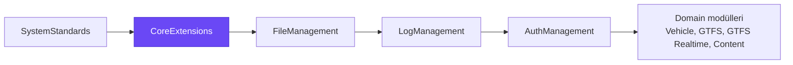
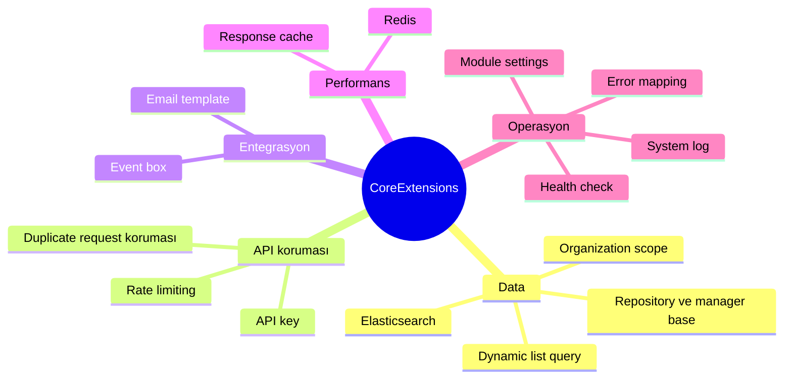
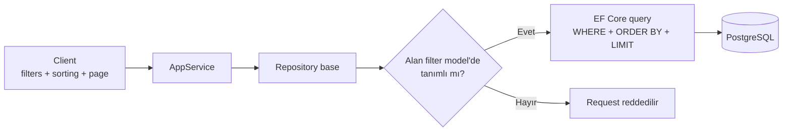
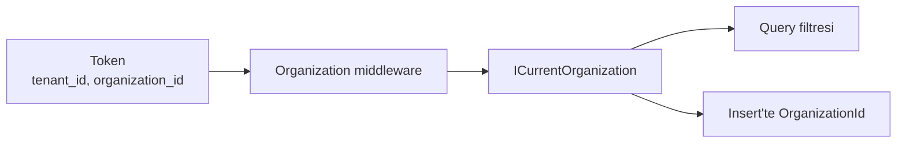
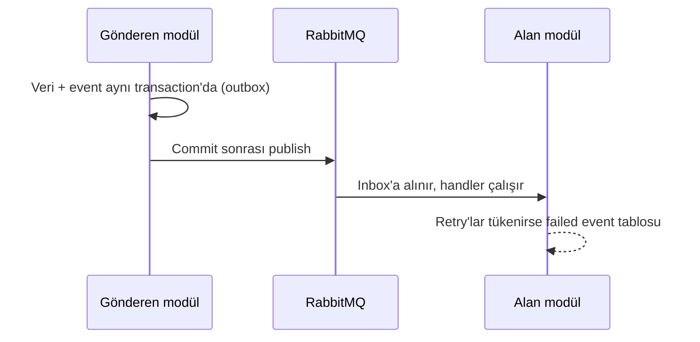
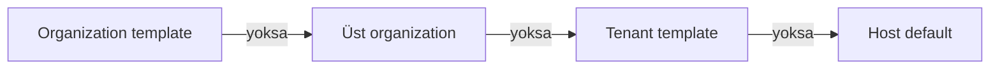
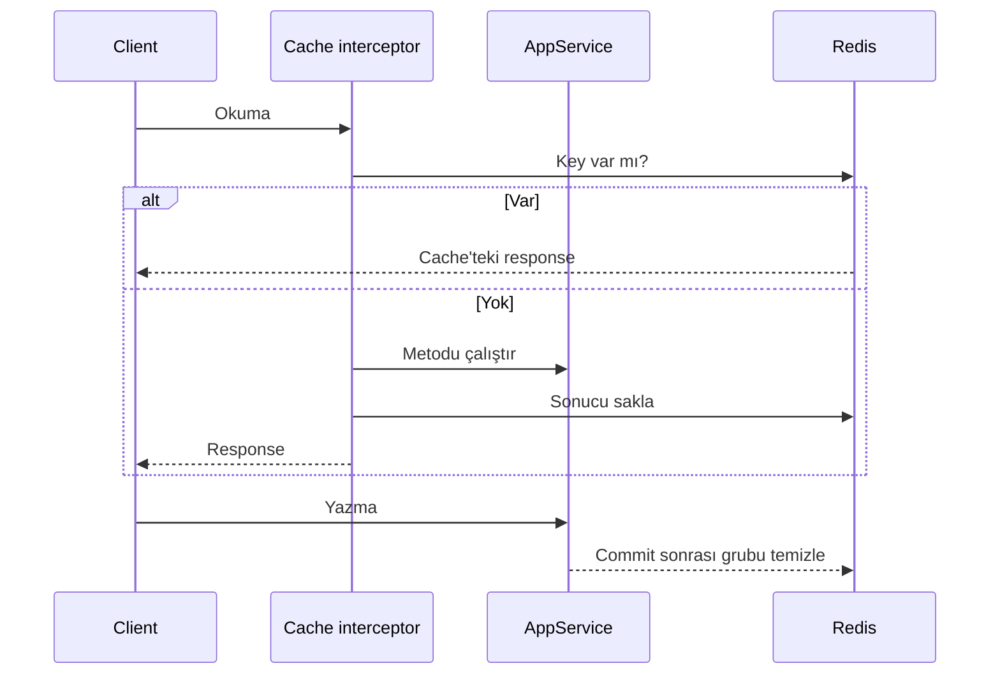

# Byd.CoreExtensions

Tüm Byd modüllerinin ortak base'i. Her modülün ihtiyaç duyduğu altyapı burada bir kez yazılır: dynamic list query,
repository ve manager base'leri, organization scope, caching, search, rate limiting, event box, email template ve error
mapping. Modüller core'u referans alır; burada olanı yeniden yazmaz.



## Capabilities



| Capability | Ne sağlar |
|---|---|
| [Dynamic list query](#dynamic-list-query) | Her entity'de filter, sort ve paging; entity başına query yazılmaz |
| [Repository ve manager base](#repository-ve-manager-base) | Bulk yazma, cache'li lookup okuma, hazır exists/not-found kontrolleri |
| [Organization scope](#organization-scope) | Data'yı token'daki organization'a göre otomatik filtreleme |
| [Rate limiting](#rate-limiting) | Attribute ile endpoint bazlı limit, değerler setting'den |
| [Duplicate request koruması](#duplicate-request-koruması) | Aynı yazma isteği iki kez işlenmez |
| [API key](#api-key) | Dış sistemlere açılan endpoint'leri API key ile koruma |
| [Event box](#event-box) | Event'lerin kaybolmadan modüller arasında taşınması |
| [Email template](#email-template) | Tenant ve organization bazında düzenlenebilir mail template'leri |
| [Response cache](#response-cache) | Service metodunu attribute ile cache'leme, yazınca otomatik temizleme |
| [Redis](#redis) | Bütün host'lar için ortak distributed cache |
| [Elasticsearch](#elasticsearch) | Aynı filter request'iyle full-text arama |
| [Module settings](#module-settings) | Modül başına limit ve davranış ayarları, restart'sız |
| [Health check](#health-check) | Database, RabbitMQ, Redis, Elasticsearch durumu tek endpoint'te |
| [System log](#system-log) | Host log'larını Elasticsearch'e akıtma |
| [Error mapping](#error-mapping) | Kodlu, localize hata mesajları |

## Dynamic list query

Her list endpoint'i aynı request'i alır: hangi alanlara göre filtrelenecek, nasıl sıralanacak, hangi sayfa getirilecek.
Modül her tablo için tek bir filter model yazar; client bu model üzerinden istediği kombinasyonu gönderir. Repository base
request'i EF Core query'sine çevirir ve filter, sort, paging'i database'de uygular. Entity başına ayrı list query'si, ayrı
input class'ı ya da `if` zinciri yazılmaz.



**Client ne gönderir**

```json
{
  "page": 1,
  "pageSize": 20,
  "sorting": [{ "field": "creationTime", "descending": true }],
  "filters": {
    "vehicleId": { "operator": "==", "value": "3f2c9a1e-..." }
  }
}
```

**Modül ne yazar**

```csharp
public class VehicleEquipmentFilter
{
    [DataTable(VehicleEquipmentFilterFields.VehicleId, VehicleEquipmentFilterFields.PropertyPaths.VehicleId)]
    public DataTableFilterItem? VehicleId { get; set; }
}

// AppService: liste ve toplam aynı filtreyle
var entities = await Repository.GetFilteredListAsync(input, cancellationToken);
var totalCount = await Repository.GetFilteredCountAsync(input, cancellationToken);
```

**Kurallar**

- Filter model bir whitelist'tir. Yalnız `[DataTable]` ile işaretli alanlar filtrelenir ve sıralanır; client entity
  property adını hiç görmez, dışarıya açılan adı gönderir.
- Property path ilişkili entity'ye inebilir (`Series.Name` gibi noktalı yazım).
- Değerler string gelir ve entity property'sinin tipine (Guid, tarih, enum, sayı) çevrilir.
- Sorting listesindeki sıra önceliği belirler. Sayfa boyutu en fazla 1000'dir.
- Aynı request Elasticsearch repository'lerinde de çalışır; orada full-text ve yazım hatasına toleranslı arama da yapılır.

## Repository ve manager base

| Base | Ne sağlar |
|---|---|
| `IExtendedRepository<T>` | Dynamic list query ve "bu kayıt başka bir tabloda kullanılıyor mu" kontrolü |
| `IBulkRepository<T>` | Change tracker'a girmeden toplu insert, update ve delete |
| `ICachedRepository<T, TCacheModel>` | Seyrek değişen lookup tablolarını cache'ten okuma; yazınca cache commit sonrası temizlenir |
| `BaseManager<TEntity, TKey>` | Kayıt var mı, zaten var mı, hepsi var mı kontrolleri; localize hatalarla |
| `BydDbContext<T>` | Soft delete ve tenant filtresine ek olarak `IsActive` ve organization filtresi |

## Organization scope

Tenant'ın altında organization katmanı vardır. Core'un middleware'i her istekte token'daki organization claim'lerini okur
ve `ICurrentOrganization`'ı doldurur. `IMultiOrganization` taşıyan entity'ler query'lerde aktif organization'a göre
otomatik filtrelenir; insert'te `OrganizationId` otomatik yazılır.



## Rate limiting

Endpoint ya da controller `[RateLimit]` ile işaretlenir. Algoritma (fixed window, sliding window, token bucket,
concurrency) ve sayacın kime ait olduğu (IP, user, tenant, API key ve kombinasyonları) attribute'tan seçilir; limit
değerleri module settings'ten gelir ve restart olmadan değişir. Limiti aşan istek body'si okunmadan 429 ve `Retry-After`
header'ıyla reddedilir.

## Duplicate request koruması

Aynı user'ın aynı body'yle tekrarlanan yazma isteğini client'tan ek header beklemeden yakalar: çift tıklama ya da retry
yüzünden bir kayıt iki kez açılmaz. İsteğin fingerprint'i method, path, user ve body'den üretilir ve süre dolana kadar
aynısı reddedilir. Açık olup olmadığı ve süre module settings'ten gelir; belirli path'ler muaf tutulabilir.

## API key

Dış sistemlere açılan endpoint'ler `[RequireApiKey]` ile korunur. Key `X-Api-Key` header'ında gelir; süresi dolmuş ya da
geçersiz key reddedilir. Çağıran key `ICurrentApiKey` ile okunur. Key'ler tenant ve organization'a bağlı üretilir.

## Event box

Modüller arası distributed event'ler outbox ve inbox üzerinden RabbitMQ ile taşınır. Event, veriyle aynı transaction'da
yazılır; commit olmayan iş event göndermez, gönderilen event kaybolmaz. İşlenemeyen event'ler ayrı bir tabloya düşer ve
API'den listelenir.



Box'lar modül ve environment adıyla sahiplenilir; aynı database'i paylaşan host'lar birbirinin event'ini işlemez.

## Email template

Modüller mail'i bir email event adıyla gönderir (`EmailTemplateManager.SendAsync`). Her event'in template'i tenant ya da
organization bazında yeniden yazılabilir; gönderimde isteğin diline göre en yakın scope'taki aktif template seçilir.



Template'ler Scriban ile doldurulur, SMTP ile kuyruktan gönderilir. Her event'in bir scope'ta tek aktif versiyonu vardır;
yeni versiyon yazılıp aktif yapılır. Event'leri kullanan modül seed eder (örneğin auth'un davet mail'i).

## Response cache

AppService okuma metodu `[CachedResponse(grup)]` ile işaretlenince sonucu Redis'te tutulur. Cache key tenant,
organization, dil ve parametrelerden kurulur; istenirse user'a özel olur. Yazma metodu `[ClearCachedResponse(grup)]`
taşır ve başarılı commit sonrası o grubu temizler.



## Redis

Host `Redis` bölümünü verirse (`IsEnabled`, `Configuration`, `KeyPrefix`) distributed cache Redis'e geçer; vermezse
memory'de kalır. Aynı sistemin host'ları aynı `KeyPrefix`'i kullanır, böylece permission ve setting cache'inin
temizlenmesi hepsine ulaşır.

## Elasticsearch

Modül bir index için `ElasticsearchRepository`'den türetip yalnız index adını verir. Liste ve count, database ile aynı
filter request'ini kullanır; ek olarak full-text ve fuzzy arama yapılır. Index yönetimi, tekil ve bulk yazma, cache'li
arama hazırdır. Doküman tenant ya da organization taşıyorsa her okuma aktif scope'la sınırlanır. Bağlantı setting'den
gelir ve değişince restart gerekmez.

## Module settings

Her modül host'u açılışta kendi settings satırını yazar. Satır o modülün rate limit, duplicate request ve event box
davranışını taşır; değerler çalışırken `api/core-extensions/module-settings` üzerinden değiştirilir ve host restart
olmadan uygulanır.

## Health check

`/health` endpoint'i genel durumu ve her kontrolü JSON olarak döner: database, RabbitMQ, Redis (açıksa) ve Elasticsearch
(kapalıysa sağlıklı sayılır). Host istediği kontrolü kapatabilir.

## System log

Host log'larını Serilog ile Elasticsearch'te `logs-<index>-<environment>` data stream'ine de yazar. Açık olup olmadığı,
minimum seviye ve index adı setting'den gelir; değişiklik restart olmadan uygulanır.

## Error mapping

Hatalar `CoreExtensions:<grup><numara>` biçiminde kodlanır ve Türkçe, İngilizce localize mesajla döner. PostgreSQL
hataları (unique, foreign key, not null, uzunluk) da kullanıcıya anlamlı mesaja çevrilir. Permission reddi, nedeni feature
ise feature'ın adıyla döner.

## Modülde kullanım

Template'ten üretilen modül core'u auth ve log paketleri üzerinden alır; ayrıca referans eklenmez. Host modül adını ve
environment'ı bildirir; ikisi de yoksa host açılmaz:

```csharp
Configure<CoreExtensionsModuleOptions>(options =>
{
    options.ModuleName = Assembly.GetEntryAssembly()?.GetName().Name?.Replace(".HttpApi.Host", string.Empty);
    options.EnvironmentName = environmentName;
});

app.UseCoreExtensions(); // module settings, rate limit, duplicate koruması ve /health
```

| Config | Ne için |
|---|---|
| `ConnectionStrings:Default` | PostgreSQL |
| `RabbitMQ` | Event box taşıyıcısı |
| `Redis` | Distributed cache (opsiyonel) |

## Geliştirme

```bash
dotnet build Byd.CoreExtensions.slnx
dotnet test Byd.CoreExtensions.slnx
```
