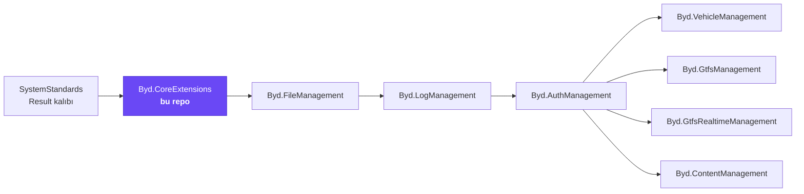
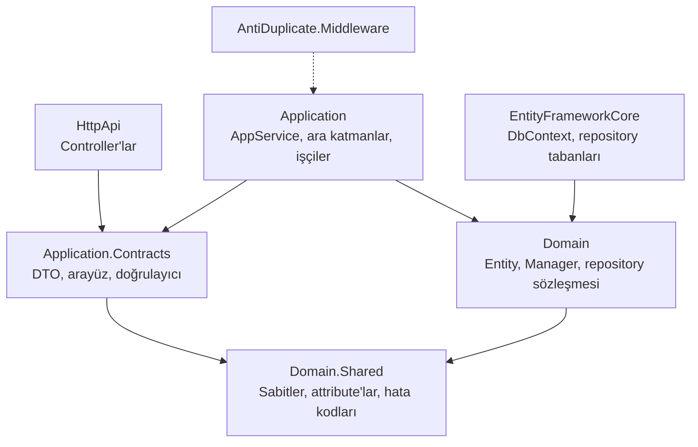
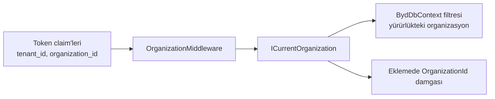
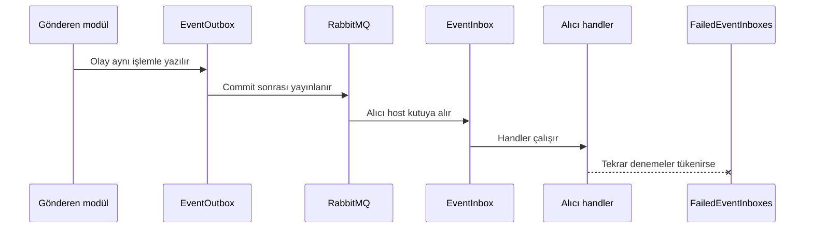
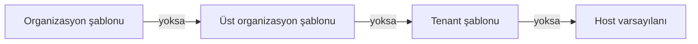
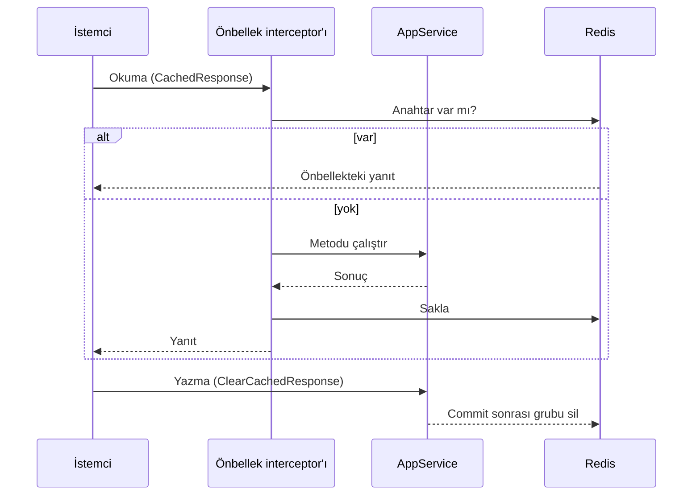
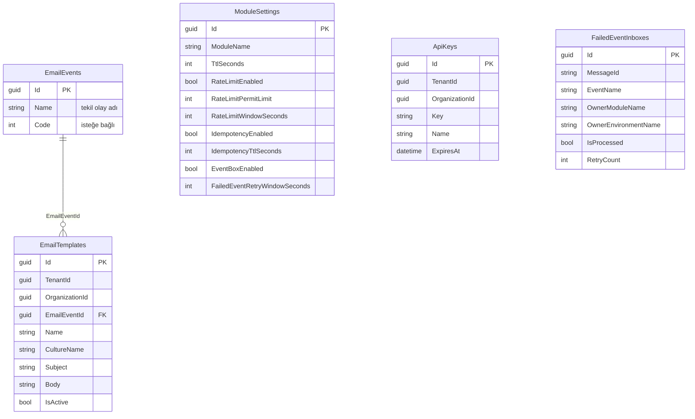

# Byd.CoreExtensions

[](https://www.nuget.org/packages/Byd.CoreExtensions.Domain)


Byd modüler platformunun zemini. Her Byd modülünün ihtiyaç duyduğu altyapı burada bir kez yazılır: filtreli listeleme,
toplu yazma, önbellek, hız sınırı, mükerrer istek koruması, API anahtarı, güvenilir olay teslimi, e-posta şablonları,
Elasticsearch, sağlık ucu ve sistem logları. Yeni bir modül bunları yeniden yazmaz, bu paketleri katman katman kullanır.

## İçindekiler

- [Platformdaki yeri](#platformdaki-yeri)
- [Bir bakışta](#bir-bakışta)
- [Katmanlar ve paketler](#katmanlar-ve-paketler)
- [Özellikler](#özellikler)
- [HTTP uçları](#http-uçları)
- [Veritabanı](#veritabanı)
- [Yetkiler](#yetkiler)
- [Ayarlar](#ayarlar)
- [Hata kodları](#hata-kodları)
- [Bir modülde kullanmak](#bir-modülde-kullanmak)
- [Geliştirme](#geliştirme)

## Platformdaki yeri

Platform modülleri bir zincir halinde birbirini tüketir. Core zincirin en altındadır; üstteki her modül core'u kendi
paketleri üzerinden dolaylı olarak alır.



## Bir bakışta

| | |
|---|---|
| Paket ailesi | `Byd.CoreExtensions.*` ve yardımcı paket `Byd.AntiDuplicate.Middleware` |
| Sürüm | `0.3.11` (`common.props`) |
| Çerçeve | ABP Framework 10.3, .NET 10 |
| Veritabanı | PostgreSQL; modül tabloları `core_extension`, ABP tabloları `abp` şemasında, adlar snake_case |
| Altyapı | RabbitMQ (dağıtık olaylar), Redis (isteğe bağlı dağıtık önbellek), Elasticsearch 9 (isteğe bağlı) |
| Bağlantı dizesi | `Default` |
| Sonuç zarfı | `SystemStandards.Core` paketindeki `Result` / `Result<T>` |

## Katmanlar ve paketler

Modül ABP'nin DDD modül şablonundan üretildi. Her katman ayrı bir NuGet paketidir; bağımlılık yönü içe doğrudur.



| Paket | Ne taşır |
|---|---|
| `Byd.CoreExtensions.Domain.Shared` | Sabitler, rota adları, `[DataTable]`, `[RateLimit]`, `[RequireApiKey]`, `[CachedResponse]`, `[ClearCachedResponse]`, hata kodu aileleri, yerelleştirme kaynağı |
| `Byd.CoreExtensions.Domain` | `BaseManager<TEntity, TKey>`, `IExtendedRepository`, `IBulkRepository`, `ICachedRepository`, `IElasticsearchRepository`, `ICurrentOrganization`, `IMultiOrganization`, e-posta yöneticileri |
| `Byd.CoreExtensions.Application.Contracts` | AppService arayüzleri, DTO'lar, FluentValidation doğrulayıcıları, `IModuleSettingProvider`, `ICurrentApiKey` |
| `Byd.CoreExtensions.Application` | AppService'ler, hız sınırı politikası, API anahtarı filtresi, yanıt önbelleği, Redis kurulumu, sağlık ucu, sistem log işçisi, `UseCoreExtensions()` |
| `Byd.CoreExtensions.EntityFrameworkCore` | `BydDbContext<T>`, `EfExtendedRepository`, `EfBulkRepository`, `EfCachedRepository`, `ElasticsearchRepository`, olay kutusu |
| `Byd.CoreExtensions.HttpApi` | Core'un kendi controller'ları (yalnız core host'u sunar) |
| `Byd.CoreExtensions.HttpApi.Client` | Core uçları için istemci proxy'leri |
| `Byd.AntiDuplicate.Middleware` | Mükerrer istek koruması ara katmanı |

## Özellikler

### 1. Dinamik filtre, sıralama ve sayfalama

Liste uçları tek bir sözleşme kullanır. Girdi `DataTableListInput<TFilter>` biçimindedir; filtrelenebilir alanlar filtre
sınıfında `[DataTable(ad, özellikYolu)]` ile tanımlanır. Repository `GetFilteredListAsync` ve `GetFilteredCountAsync` ile
filtreyi, sıralamayı ve sayfalamayı veritabanında uygular.

| Operatör | Anlamı | Operatör | Anlamı |
|---|---|---|---|
| `==` / `!=` | Eşit / eşit değil | `contains` / `notContains` | İçerir / içermez (büyük-küçük harf duyarsız) |
| `>` / `>=` | Büyük / büyük eşit | `between` | İki değer arasında |
| `<` / `<=` | Küçük / küçük eşit | `in` | Listedeki değerlerden biri |
| `isNull` / `isNotNull` | Boş / dolu | `match` / `fuzzy` | Yalnız Elasticsearch: kelime bazlı tam metin / yazım hatasına toleranslı |

### 2. Repository ve Manager tabanları

| Tip | Ne sağlar |
|---|---|
| `IExtendedRepository<T>` | Filtreli liste ve sayım, `IsDataUsedAsync` ile "kayıt başka tabloda kullanılıyor mu" kontrolü |
| `IBulkRepository<T>` | Değişiklik izleyicisi dışında toplu ekleme, güncelleme ve silme (EFCore.BulkExtensions) |
| `ICachedRepository<T, TCacheModel>` | Seyrek değişen lookup tablolarını önbellekten okuma; yazmada liste commit sonrası temizlenir |
| `BaseManager<TEntity, TKey>` | `TryGetByIdAsync`, `CheckExistsAsync`, `CheckAlreadyExistsAsync`, `CheckAllExistAsync`; yerelleştirilmiş hatalarla |
| `BydDbContext<T>` | ABP soft-delete ve tenant filtresine ek olarak `IHasIsActive` ve `IMultiOrganization` filtresi; organizasyonu eklemede damgalar |

### 3. Organizasyon kapsamı

Tenant'ın altında bir organizasyon katmanı vardır. `OrganizationMiddleware` her istekte token'daki organizasyon
claim'lerini okur ve `ICurrentOrganization`'ı kurar (`Id`, `Name`, `ParentId`, `ParentName`). `IMultiOrganization`
taşıyan entity'ler sorgularda otomatik olarak yürürlükteki organizasyonla sınırlanır.



### 4. Hız sınırı

Uç ya da controller `[RateLimit]` ile işaretlenir. Algoritma ve bölümleme stratejisi attribute'tan, limitler modül
ayarından gelir; `RateLimitStateWorker` ayarı periyodik olarak yeniler.

| Algoritma | Davranış | Bölümleme | Sayaç kime ait |
|---|---|---|---|
| `fixedWindow` | Her pencere başında sayaç sıfırlanır | `ip` | İstemci IP'si |
| `slidingWindow` | Pencere dilimlere bölünür, sınır daha yumuşaktır | `user` | Kullanıcı |
| `tokenBucket` | Token'lar aralıklarla yenilenir, kısa patlamalara izin verir | `tenant` | Kiracı |
| `concurrency` | Aynı anda işlenen istek sayısını sınırlar | `client` | API anahtarı / istemci |
| | | `userAndEndpoint` | Kullanıcı + uç |
| | | `tenantAndUser` | Kiracı + kullanıcı |

Sınırı aşan istek gövdesi okunmadan `CoreExtensions:010010` (çok fazla istek) ile reddedilir.

### 5. Mükerrer istek koruması

`Byd.AntiDuplicate.Middleware` aynı kullanıcının aynı gövdeyle tekrarlanan yazma isteğini, istemciden ek bir başlık
beklemeden yakalar. İsteğin parmak izi yöntem, yol, kullanıcı ve gövdeden üretilir; aynı parmak izi süre dolana kadar
`CoreExtensions:030001` ile reddedilir.

| Ayar | Varsayılan | Aralık |
|---|---|---|
| Açık mı | açık | |
| Süre | 300 sn | 1 sn ile 86.400 sn arası |
| İncelenen en büyük gövde | 1 MB | |
| Muafiyetler | `CoreExtensionsModuleOptions.ExcludePaths` | `"/get"` gibi yöntem ya da `"/api/x"` gibi yol öneki |

### 6. Modül ayarları

Her modül host'u açılışta `ModuleSettings` tablosuna kendi satırını yazar. Satır o modülün hız sınırı, idempotency ve olay
kutusu davranışını taşır; değerler çalışırken API'den değiştirilir. Kod tarafında `IModuleSettingProvider.FindCurrentAsync`
istek yolunda, `RefreshHostAsync` açılış ve işçi yolunda kullanılır.

### 7. API anahtarı

Dış sistemlere açılan uçlar `[RequireApiKey]` ile korunur. Anahtar `X-Api-Key` başlığında gelir; doğrulama filtresi
anahtarı önbellekteki durumla karşılaştırır, süresi dolmuşsa reddeder. Çağıran anahtar `ICurrentApiKey` ile okunur.

### 8. Güvenilir olay teslimi

ABP'nin dağıtık olay gelen ve giden kutuları (inbox/outbox) core'un DbContext'ine bağlıdır; taşıyıcı RabbitMQ'dur. Kalıcı
olarak işlenemeyen gelen olaylar `FailedEventInboxes` tablosuna düşer ve API'den listelenir. Kutular modül adı ve ortam
adıyla sahiplenilir, böylece aynı veritabanını paylaşan host'lar birbirinin olayını işlemez.



### 9. E-posta şablonları

Modüller e-postayı `EmailTemplateManager.SendAsync(olayAdı, alıcı, model)` ile gönderir. Olaylar `EmailEvents` lookup
tablosunda durur; olayı kullanan modül kendi olayını ve host kapsamındaki varsayılan şablonunu seed eder. Şablon isteğin
diline göre en yakın kapsamdan seçilir ve Scriban ile doldurulur (`{{ ad }}`). Gönderim ABP'nin SMTP göndericisiyle
kuyruğa alınır.



Her olayın bir kapsamda tek aktif sürümü vardır. Aktif sürüm silinemez; etkinleştirme kendi ucundan yapılır. SMTP ayarları
(`Abp.Mailing.*`) host'tan gelir; parola şifreli ayardır, appsettings'e düz yazılmaz.

### 10. Yanıt önbelleği

AppService okuma metodu `[CachedResponse(grup)]` ile işaretlenince sonucu Redis'te saklanır. Anahtar modül, tenant,
organizasyon, kültür, metot ve girdilerden kurulur; `IsUserScoped` açıksa kullanıcı da eklenir. Yazma metodu
`[ClearCachedResponse(grup)]` taşır ve hatasız bitince grubu commit sonrası siler. `ICachedResponseSource` taşıyan bir
entity değiştiğinde de aynı gruptaki yanıtlar silinir.



Interceptor arayüz üzerinden gelen çağrıyı yakalar; servisin kendi içinden çağırdığı metot önbelleğe girmez.

### 11. Redis

Host `Redis` bölümünü verir (`IsEnabled`, `Configuration`, `KeyPrefix`). Bölüm yoksa ya da kapalıysa dağıtık önbellek
bellek içinde kalır. Aynı sistemin host'ları aynı `KeyPrefix`'i kullanır ki izin ve ayar önbelleği temizliği hepsine
ulaşsın.

### 12. Elasticsearch

Her modül `IElasticsearchRepository<TBelge, TKey>`'i doğrudan alır ya da `ElasticsearchRepository<TBelge, TKey>`'den
türetip yalnız `IndexName`'i verir. Liste ve sayım veritabanıyla aynı filtre sözleşmesini kullanır.

| Grup | Metotlar |
|---|---|
| İndeks | oluşturma, varlık kontrolü, temizleme, bağlantı kontrolü |
| Yazma | tekil ve toplu ekleme, güncelleme, silme (yazılan kayıt hemen okunur) |
| Okuma | kimlikle, alanla, tarih aralığıyla; `AnyAsync`, sayım |
| Arama | filtreli liste ve sayım, ikisini tek istekte dönen `SearchAsync`, kısa süre önbellekleyen `CachedSearchAsync` |

Belge `IMultiTenant` ya da `IMultiOrganization` taşıyorsa her okuma yürürlükteki kapsamla sınırlanır. Bağlantı ABP
ayarlarından gelir ve ayar değişince host yeniden başlamadan yeniden kurulur.

### 13. Sağlık ucu

`UseCoreExtensions()` `/health` ucunu açar. Cevap genel durumu ve her yoklamayı JSON olarak döner.

| Yoklama | Ne zaman kayıtlı |
|---|---|
| `database` | Her zaman |
| `rabbitmq` | Her zaman |
| `redis` | Redis açıkken |
| `elasticsearch` | Her zaman; ayarlarda kapalıysa sağlıklı sayılır |

Host bir yoklamayı ya da ucun kendisini `PreConfigure<CoreExtensionsHealthCheckOptions>(...)` ile kapatabilir.

### 14. Sistem logları

Host `Program.cs`'te logger'ı `ConfigureSystemLog(ortamAdı)` ile kurar. Elasticsearch ve sistem log ayarı açıkken loglar
`logs-<indeks>-<ortam>` veri akışına da yazılır. `SystemLogWorker` ayarları periyodik okur; değişiklik host yeniden
başlamadan uygulanır.

### 15. Hata eşlemesi ve yerelleştirme

Hata kodları `CoreExtensions:<GG><NNNN>` biçimindedir: iki haneli grup konuyu, dört haneli numara hatayı söyler. PostgreSQL
sürücü hataları (benzersizlik, yabancı anahtar, boş olamaz, uzunluk) yerelleştirilmiş mesajlara çevrilir. Mesajlar Türkçe
ve İngilizce gelir.

## HTTP uçları

Uçları core host'u sunar. Tüm cevaplar `Result<T>` zarfıyla döner.

| Yöntem | Yol | Ne yapar |
|---|---|---|
| `GET` | `api/core-extensions/api-keys/{id}` | API anahtarını getirir |
| `POST` | `api/core-extensions/api-keys` | Yeni API anahtarı üretir |
| `GET` | `api/core-extensions/email-events` | Seed edilmiş tüm e-posta olaylarını getirir |
| `GET` | `api/core-extensions/email-events/{id}` | E-posta olayını getirir |
| `GET` | `api/core-extensions/email-templates` | Kapsamdaki tüm şablon sürümlerini getirir |
| `GET` | `api/core-extensions/email-templates/{id}` | Şablonu getirir |
| `POST` | `api/core-extensions/email-templates` | Kapsamda yeni şablon açar |
| `PUT` | `api/core-extensions/email-templates/{id}` | Ad, konu ve içeriği günceller |
| `DELETE` | `api/core-extensions/email-templates/{id}` | Pasif şablonu siler |
| `POST` | `api/core-extensions/email-templates/{id}/activate` | Pasif şablonu kendi olay ve dilinde aktif yapar |
| `GET` | `api/core-extensions/failed-event-inboxes/{id}` | Başarısız olayı getirir |
| `POST` | `api/core-extensions/failed-event-inboxes/filtered-list` | Başarısız olayları filtreli listeler |
| `POST` | `api/core-extensions/failed-event-inboxes/filtered-count` | Başarısız olay sayısını döner |
| `GET` | `api/core-extensions/module-settings` | Tüm modül ayarlarını getirir |
| `GET` | `api/core-extensions/module-settings/{id}` | Modül ayarını getirir |
| `GET` | `api/core-extensions/module-settings/{id}/rate-limit` | Hız sınırı alanlarını getirir |
| `GET` | `api/core-extensions/module-settings/{id}/idempotency` | Idempotency alanlarını getirir |
| `GET` | `api/core-extensions/module-settings/{id}/event-box` | Olay kutusu alanlarını getirir |
| `POST` | `api/core-extensions/module-settings` | Yeni modül için ayar kaydı açar |
| `PUT` | `api/core-extensions/module-settings/{id}` | Ayar kaydını günceller |
| `DELETE` | `api/core-extensions/module-settings/{id}` | Ayar kaydını siler |
| `GET` | `/health` | Sağlık durumu |

## Veritabanı



| Tablo | Şema | Ne tutar |
|---|---|---|
| `CoreExtensionsModuleSettings` | `core_extension` | Modül başına hız sınırı, idempotency ve olay kutusu ayarları |
| `CoreExtensionsApiKeys` | `core_extension` | Dış istemcilere verilen API anahtarları |
| `CoreExtensionsEmailEvents` | `core_extension` | E-posta olayları (lookup, modüller seed eder) |
| `CoreExtensionsEmailTemplates` | `core_extension` | Kapsam ve dil başına e-posta şablon sürümleri |
| `EventInbox` / `EventOutbox` | `core_extension` | ABP dağıtık olay kutuları |
| `FailedEventInboxes` | `core_extension` | Kalıcı olarak işlenemeyen gelen olaylar |
| `Settings`, `SettingDefinitions` | `abp` | ABP ayar yönetimi |

## Yetkiler

| İzin | Ne verir |
|---|---|
| `CoreExtensions.ApiKeys.View` / `.Manage` | API anahtarlarını görmek / üretmek |
| `CoreExtensions.EmailTemplates.View` / `.Manage` | E-posta olay ve şablonlarını görmek / yönetmek |
| `CoreExtensions.FailedEventInboxes.View` | Başarısız olay kutusunu görmek |
| `CoreExtensions.ModuleSettings.View` / `.Manage` | Modül ayarlarını görmek / yönetmek |

## Ayarlar

ABP ayarlarıdır; değer appsettings'teki `Settings` bölümünden ya da ayar yönetiminden gelir.

| Ayar | Ne yapar |
|---|---|
| `CoreExtensions.Caching.IsEntityCachingEnabled` | Önbellekli repository okumalarını açar/kapatır |
| `CoreExtensions.Caching.IsResponseCachingEnabled` | `[CachedResponse]` yanıt önbelleğini açar/kapatır |
| `CoreExtensions.Elasticsearch.IsEnabled` | Elasticsearch istemcisini açar (varsayılan kapalı) |
| `CoreExtensions.Elasticsearch.Url` / `.UserName` / `.Password` | Küme bağlantısı; parola şifreli ayardır |
| `CoreExtensions.Elasticsearch.IsTraceMode` | İstek/yanıt izini açar |
| `CoreExtensions.SystemLog.IsElasticsearchEnabled` | Host loglarını Elasticsearch'e de yazar |
| `CoreExtensions.SystemLog.IndexName` | Log veri akışı adı (boşsa modül adı) |
| `CoreExtensions.SystemLog.MinimumLevel` | En düşük log seviyesi |
| `CoreExtensions.SystemLog.IsSelfLogEnabled` / `.FailureLogPath` | Serilog iç hatalarının yazılıp yazılmayacağı ve nereye |
| `CoreExtensions.SystemLog.RefreshIntervalSeconds` | Log ayarlarının yeniden okunma aralığı |

## Hata kodları

| Kod öneki | Aile | Örnekler |
|---|---|---|
| `CoreExtensions:01` | `GeneralExceptionCodes` | kayıt bulunamadı, zaten var, desteklenmeyen filtre operatörü, geçersiz sayfa, çok fazla istek, izin yok, özellik kapalı |
| `CoreExtensions:02` | `ApiKeyExceptionCodes` | anahtar yok, geçersiz, süresi dolmuş |
| `CoreExtensions:03` | `IdempotencyExceptionCodes` | mükerrer istek |
| `CoreExtensions:04` | `ModuleSettingExceptionCodes` | modül adı eksik/tekrarlı, geçersiz süre ve limitler, host bildirimi eksik |
| `CoreExtensions:05` | `EmailTemplateExceptionCodes` | şablon söz dizimi hatalı, şablon yok, aktif şablon silinemez |
| `CoreExtensions:06` | `ElasticsearchExceptionCodes` | Elasticsearch kapalı, toplu yazma başarısız |
| PostgreSQL | `PostgresExceptionCodes` | `23505` benzersizlik, `23503` yabancı anahtar, `23502` boş olamaz, `22001` uzunluk |

## Bir modülde kullanmak

Platform şablonundan üretilen modüller core'u auth ve log paketleri üzerinden dolaylı olarak alır; doğrudan referans yalnız
o yolun getirmediği bir core tipi gerekiyorsa eklenir.

**1. Katman başına paket ve `[DependsOn]`**

| Tüketen katman | Paket | Modül sınıfı |
|---|---|---|
| `<Modül>.Domain.Shared` | `Byd.CoreExtensions.Domain.Shared` | `CoreExtensionsDomainSharedModule` |
| `<Modül>.Domain` | `Byd.CoreExtensions.Domain` | `CoreExtensionsDomainModule` |
| `<Modül>.Application.Contracts` | `Byd.CoreExtensions.Application.Contracts` | `CoreExtensionsApplicationContractsModule` |
| `<Modül>.Application` | `Byd.CoreExtensions.Application` | `CoreExtensionsApplicationModule` |
| `<Modül>.EntityFrameworkCore` | `Byd.CoreExtensions.EntityFrameworkCore` | `CoreExtensionsEntityFrameworkCoreModule` |

`HttpApi` katmanı core'un HttpApi paketini almaz; alırsa core'un controller'ları tüketen host'ta da açılır.

**2. Host bildirimi (zorunlu)**

```csharp
public override void PreConfigureServices(ServiceConfigurationContext context)
{
    ServiceConfigurationContextExtension.ResolveSchemaAndPrefix();
}

public override void ConfigureServices(ServiceConfigurationContext context)
{
    var environmentName = context.Services.GetHostingEnvironment().EnvironmentName;
    Configure<CoreExtensionsModuleOptions>(options =>
    {
        options.ModuleName = Assembly.GetEntryAssembly()?.GetName().Name?.Replace(".HttpApi.Host", string.Empty);
        options.EnvironmentName = environmentName;
    });
}
```

Modül adı ya da ortam adı verilmezse host açılışta durur; bu bilinçli bir davranıştır.

**3. Ara katman sırası**

```csharp
app.UseCorrelationId();
app.UseRouting();
app.UseRateLimiter();
app.UseCoreExtensions();
app.UseConfiguredEndpoints();
```

`UseCoreExtensions()` modül ayarı satırını yazar, hız sınırı ve API anahtarı durumunu ısıtır, mükerrer istek korumasını
ve sağlık ucunu ekler. Bu çağrı olmadan host açılmaz.

**4. Host yapılandırması**

| Bölüm | Ne verir |
|---|---|
| `ConnectionStrings:Default` | PostgreSQL bağlantısı |
| `RabbitMQ:Connections:Default`, `RabbitMQ:EventBus` | Olay taşıyıcı; `ClientName` host başına tekil, `ExchangeName` ortak |
| `Redis` | `IsEnabled`, `Configuration`, `KeyPrefix` (isteğe bağlı) |
| `Settings` | Yukarıdaki ABP ayarlarının başlangıç değerleri |

## Geliştirme

```bash
dotnet build Byd.CoreExtensions.slnx
dotnet test Byd.CoreExtensions.slnx
```

Host `host/Byd.CoreExtensions.HttpApi.Host` altındadır. Paket sürümü `common.props` içindeki `<Version>` alanından okunur.
